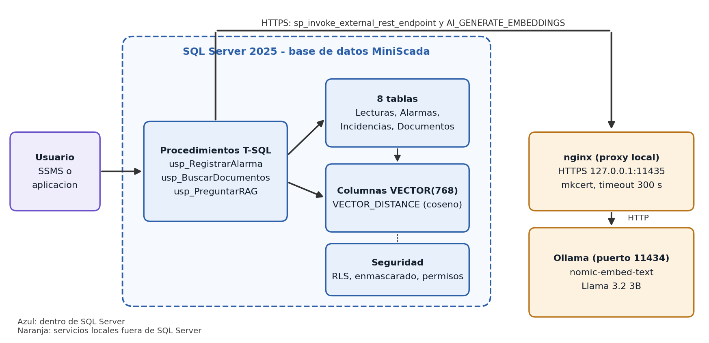
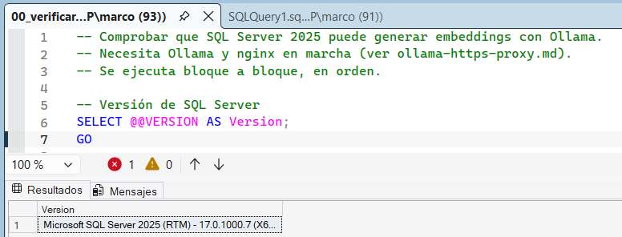
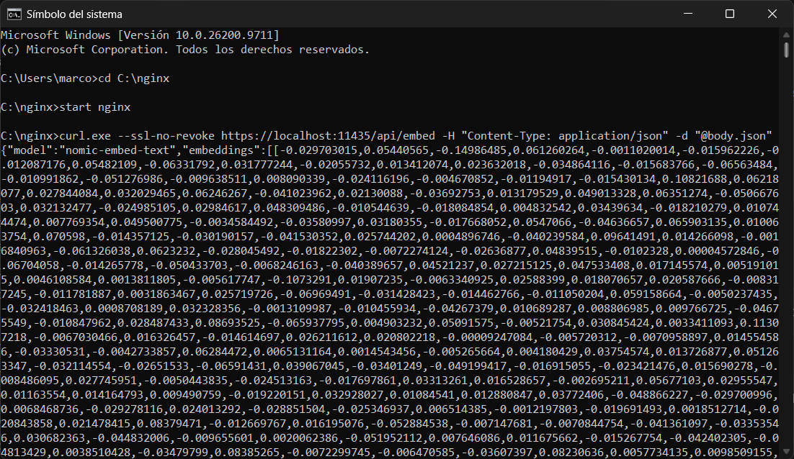
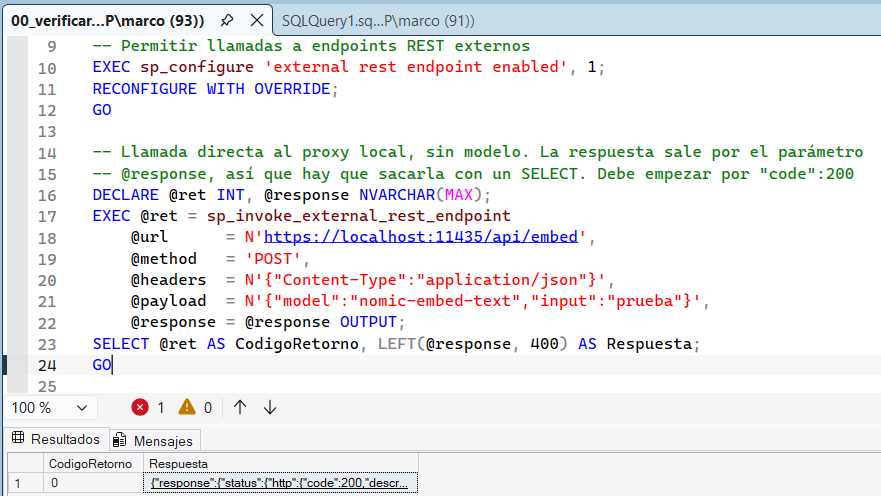
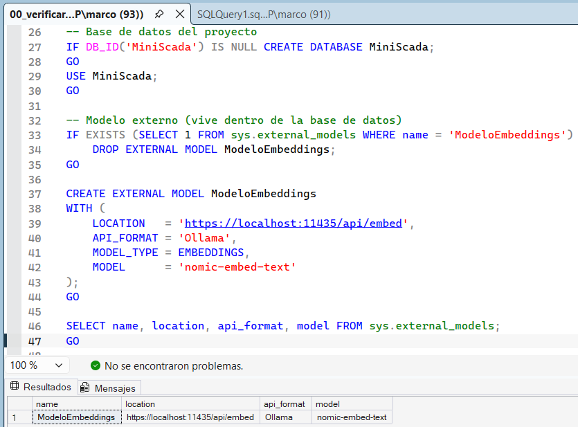
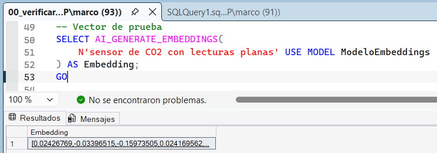
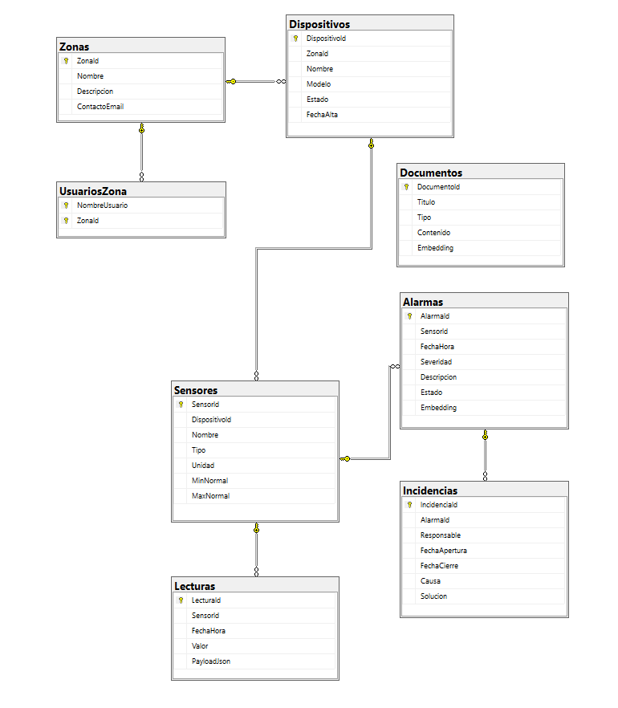
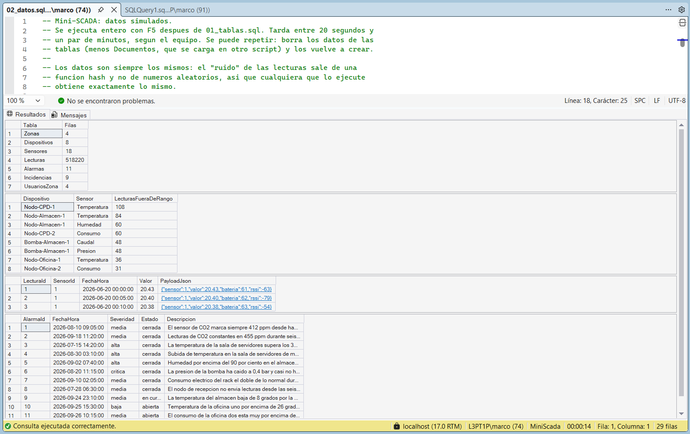

# Mini-SCADA con SQL Server 2025

Mini proyecto de Big Data para practicar lo de la certificación DP-800 (SQL AI Developer Associate). Voy a por el nivel 3 del enunciado: diseño de base de datos, seguridad y optimización, embeddings, búsqueda vectorial y un RAG con modelo local.

Elegí este tema ya que trabajé en una empresa dedicada al sector del IoT, concretamente en diseños y remodelaciones de edificios inteligentes. Tengo experiencia creando y utilizando sistemas SCADA.
Lo que espero aprender de este proyecto es a integrar inteligencia artificial para detectar incidencias, basándose en anteriores sucesos de ese mismo sistema, y además poder consultar esa información en lenguaje natural.

Todavía está en desarrollo y voy actualizando este README según avanzo.

## De qué va

Una base de datos en SQL Server 2025 que guarda lecturas de sensores, alarmas, incidencias y manuales de equipos IoT, como haría un SCADA pequeño. Los datos los simulo con un script.

Sobre eso quiero poder preguntar en lenguaje natural, por ejemplo "el sensor de CO2 marca siempre lo mismo", y que SQL Server encuentre las alarmas parecidas y el manual que toca por significado y no por palabras exactas. Después, un modelo local redacta la respuesta con lo que ha encontrado (RAG).


## Cómo lo planteo

```
Usuario -> procedimientos T-SQL -> SQL Server 2025 (tablas, vectores, seguridad)
                                        |
                                      HTTPS
                                        |
                              nginx (proxy local) -> Ollama
```

SQL Server solo llama a servicios HTTPS y Ollama habla HTTP, por eso hay un proxy en medio. Cuando tenga el diagrama definitivo lo cambiaré por una imagen.

<!-- FASE 5: guarda el diagrama como docs/images/arquitectura.png y sustituye el bloque de arriba por la línea . -->

## Tecnologías

Todo funciona en local, en mi portátil con Windows 11:

- SQL Server 2025 (RTM, versión 17.0.1000.7) y T-SQL
- SQL Server Management Studio (SSMS) 22.10.2
- Ollama 0.40.9, con el modelo de embeddings `nomic-embed-text` (vectores de 768 dimensiones) y un LLM pequeño para el RAG
- nginx 1.30.6 y mkcert 1.4.4 para el proxy HTTPS local
- Git y GitHub

## Montar el entorno

Esta fue la parte que más tiempo me llevó, y no tuvo nada que ver con SQL sino con conseguir que SQL Server hablara con Ollama. SQL Server 2025 solo llama a servicios por HTTPS y Ollama sirve en HTTP, así que tuve que poner un proxy en medio. Al final el orden que me funcionó fue este:

1. Ollama y el modelo `nomic-embed-text`, probado primero con curl directamente contra Ollama.
2. mkcert para crear un certificado local, e importar su entidad certificadora en el almacén del equipo. SQL Server corre como servicio y no usa los certificados de mi usuario, y eso me costó entenderlo.
3. nginx escuchando en `https://127.0.0.1:11435` y reenviando todo a Ollama.
4. En SQL Server, activar las llamadas REST externas, comprobar que llegan al proxy, crear el modelo externo y generar un primer vector.

Los pasos con los comandos están en [setup/ollama-https-proxy.md](setup/ollama-https-proxy.md), y las comprobaciones en SQL en [setup/00_verificar_entorno.sql](setup/00_verificar_entorno.sql).

### Lo que me fue fallando

- **curl se quejaba de la revocación del certificado** (`CRYPT_E_NO_REVOCATION_CHECK`). Los certificados de mkcert no llevan información de revocación y curl en Windows lo exige. Se arregla con `--ssl-no-revoke`.
- **mkcert y nginx "no se reconocen" en PowerShell.** mkcert hacía falta cerrar y abrir la terminal después de instalarlo con winget, y nginx en PowerShell hay que lanzarlo como `.\nginx`.
- **El JSON de curl en PowerShell.** PowerShell estropea las comillas dobles, y curl daba errores raros como "invalid character" o "Port number was not a decimal number". Lo resolví guardando el cuerpo de la petición en un `body.json` y enviándolo con `-d "@body.json"`.
- **No sabía si la llamada había funcionado.** Al ejecutar `sp_invoke_external_rest_endpoint` solo me ponía "Los comandos se han completado correctamente". Resulta que la respuesta no sale como tabla sino por el parámetro `@response OUTPUT`, así que hay que guardarla en una variable y sacarla con un `SELECT`. Una vez hecho eso se ve `CodigoRetorno` 0 y `"code":200`.

### Cómo comprobé que funciona

Primero la versión de SQL Server:



Después el proxy, con curl, devolviendo el vector de `nomic-embed-text`:



La llamada desde SQL Server al proxy, con código de retorno 0 y el 200 en la respuesta:



El modelo externo creado dentro de la base de datos `MiniScada`, con la consulta a `sys.external_models`:



Y el primer vector generado con `AI_GENERATE_EMBEDDINGS` a partir de una frase de prueba:



## Base de datos

La base de datos se llama `MiniScada` y tiene 8 tablas. El script que las crea está en [database/01_tablas.sql](database/01_tablas.sql) y se puede ejecutar entero las veces que haga falta, porque borra y vuelve a crear las tablas.



| Tabla | Para qué sirve |
| --- | --- |
| Zonas | Áreas o edificios donde están los equipos. Guarda un email de contacto, que más adelante enmascaro |
| Dispositivos | Nodos IoT de cada zona, con su modelo y su estado |
| Sensores | Sensores de cada dispositivo: qué miden, en qué unidad y su rango normal (mínimo y máximo) |
| Lecturas | Histórico de mediciones: sensor, fecha, valor y el mensaje JSON original. Es la tabla grande |
| Alarmas | Eventos anómalos de un sensor, con severidad, estado y su embedding |
| Incidencias | Cómo se resolvió cada alarma: responsable, causa y solución |
| Documentos | Manuales y procedimientos, con su embedding |
| UsuariosZona | Qué zonas ve cada usuario (Row-Level Security) |

### Por qué la diseñé así

Lo organicé como lo estaría en un edificio de verdad. Una zona tiene varios dispositivos, un dispositivo tiene varios sensores, y cada sensor genera muchas lecturas y puede disparar alarmas. Por eso las cuatro primeras tablas forman una cadena de Zonas a Dispositivos a Sensores, y de ahí salen Lecturas y Alarmas. Después, cada alarma puede tener una incidencia donde se anota qué la causó y cómo se arregló. Esas incidencias son las que luego quiero encontrar por significado cuando aparezca una alarma parecida.

En Lecturas guardo solo lo básico (sensor, fecha, valor y el JSON original del dispositivo) porque es la tabla que va a tener más de 500.000 filas, y quiero que sea ligera. De momento no tiene ningún índice aparte de la clave primaria, a propósito: así en la parte de optimización puedo medir cómo era la consulta antes y cómo mejora después de crearlo.

Documentos no está unida a ninguna otra tabla porque son manuales y procedimientos generales de los equipos, que valen para cualquier zona. UsuariosZona sirve para la seguridad por filas: dice qué zonas puede ver cada usuario.

Las columnas `Embedding` de Alarmas y Documentos son de tipo `VECTOR(768)`, porque `nomic-embed-text` genera vectores de 768 dimensiones. Ahora están vacías (aceptan `NULL`) y las relleno en la fase de embeddings.

### Restricciones

Para que no entren datos inválidos uso claves foráneas y restricciones `CHECK`. Por ejemplo:

- En Sensores, el valor mínimo normal tiene que ser menor que el máximo.
- En Incidencias, la fecha de cierre no puede ser anterior a la de apertura.
- La severidad de una alarma solo puede ser baja, media, alta o crítica, y el estado de un dispositivo o de una alarma solo puede tomar los valores previstos.
- El campo `PayloadJson` de Lecturas tiene que ser un JSON válido.
- Dentro de una zona no puede haber dos dispositivos con el mismo nombre, y dentro de un dispositivo tampoco dos sensores con el mismo nombre.

### Datos simulados

Los datos los genera [database/02_datos.sql](database/02_datos.sql), que se ejecuta después de crear las tablas. Tarda unos 15 segundos en mi equipo y se puede repetir, porque borra y vuelve a crear los datos.

Hay 4 zonas, 8 dispositivos y 18 sensores. De cada sensor genero una lectura cada 5 minutos durante 100 días, del 20 de junio al 27 de septiembre de 2026, y eso da unas 518.000 lecturas. Cada valor sigue un ciclo diario (por ejemplo, más CO2 y más temperatura por la tarde en las oficinas) con una pequeña variación. Esa variación no sale de números aleatorios sino de una función hash, así que cualquiera que ejecute el script obtiene exactamente los mismos datos que yo.



Después meto 11 anomalías a propósito, cada una con su alarma y, casi todas, con su incidencia donde se cuenta la causa y la solución:

- Dos sensores de CO2 que se quedan en un valor fijo durante horas. El valor está dentro del rango normal, lo raro es que no se mueve, así que no se detecta mirando solo el rango.
- Dos subidas de temperatura en la sala de servidores, una por un fallo de refrigeración y otra tras un corte de luz.
- Humedad muy alta en el almacén por una fuga de agua.
- Caída de presión y de caudal en la bomba por perder el cebado.
- Consumo eléctrico doble en la sala de servidores de madrugada.
- Cinco horas sin lecturas en recepción por perder la conexión.
- Tres anomalías más cuyas alarmas siguen abiertas o en curso: temperatura baja en el almacén, temperatura alta en una oficina y consumo alto en la otra.

Las alarmas y sus incidencias las escribí con un lenguaje natural y con casos parecidos entre sí, para que más adelante la búsqueda por significado tenga algo que encontrar.


## Cómo voy

- [x] Comprobar que SQL Server puede generar embeddings con Ollama
- [ ] Diseño de la base de datos y T-SQL
- [ ] Seguridad (Row-Level Security, Dynamic Data Masking) y optimización de una consulta
- [ ] Embeddings y búsqueda semántica
- [ ] RAG con modelo local
- [ ] Documentar el uso de IA durante el desarrollo

Las veces que he usado IA y cómo comprobé lo que me daba las voy apuntando en [docs/uso-de-ia.md](docs/uso-de-ia.md).

<!-- Cambia [ ] por [x] cuando termines cada punto. Al acabar el proyecto puedes borrar esta lista o dejarla marcada. -->

## Cómo probarlo

De momento solo está la comprobación del entorno:

1. Instalar Ollama y montar el proxy siguiendo [setup/ollama-https-proxy.md](setup/ollama-https-proxy.md).
2. Ejecutar [setup/00_verificar_entorno.sql](setup/00_verificar_entorno.sql) en SSMS, bloque a bloque.

Los certificados no están en el repositorio: cada uno tiene que generar los suyos con mkcert.

<!-- FASE 5: sustituye esto por la instalación completa paso a paso: el orden de los scripts de database/ y ai/, qué hay que tener en marcha y cuánto tarda. Hazlo después de la prueba de reproducibilidad, clonando el repo en otra carpeta, para que sea el orden real. -->

<!--
SECCIONES QUE VAS A AÑADIR AL README
Cuando llegues a cada fase, copia el título, escribe la sección con tus palabras y borra el comentario correspondiente. Todas van debajo de "Cómo probarlo" o donde te parezca natural. Las guías de cada paso están en el documento de la guía.

## Seguridad (Fase 2)
Quién ve qué, en una tabla de usuario, permiso y resultado. Qué hace la seguridad por filas por zona, qué oculta el enmascarado de datos y por qué el técnico tiene solo lo necesario. Capturas: 02_rls_admin.png, 02_rls_tecnico.png, 02_ddm.png y 02_deny.png.

## Optimización de una consulta (Fase 2)
Qué consulta elegiste y por qué, cómo era el plan antes (tipo de acceso, logical reads, tiempo), qué índice creaste y cómo quedó después. Explica por qué mejora, o por qué no mejora tanto. Capturas: 02_plan_antes.png y 02_plan_despues.png.

## Embeddings (Fase 3)
El enunciado pide cinco cosas: qué modelo usas, qué columnas se convierten en vector, qué dimensión tiene, cómo se generan y cómo se guardan en SQL Server. Cuéntalo con tus palabras. Captura: 03_embeddings.png.

## Búsqueda semántica (Fase 3)
Una tabla con las cinco preguntas que probaste, qué salió primero y si acertó, incluidos los fallos. Y por qué usas la métrica coseno, que el enunciado exige justificar. Capturas: 03_ranking_1.png y siguientes.

## RAG (Fase 4)
Qué modelo de lenguaje elegiste y por qué, cómo funciona el flujo (pregunta, documentos recuperados, contexto, respuesta) y la diferencia entre usar el modelo solo y usar RAG, con el ejemplo de la misma pregunta de las dos formas. Capturas: 04_rag_salida.png, 04_sin_rag.png y 04_con_rag.png.

## Uso de IA durante el desarrollo
Un resumen corto de para qué usaste IA y un enlace a docs/uso-de-ia.md, donde van las fichas con prompt, respuesta, qué aceptaste, qué corregiste y cómo lo verificaste.

## Ejemplos (Fase 5)
Dos o tres consultas con su resultado, las que mejor enseñen el proyecto.

## Conclusiones (Fase 5)
Qué has aprendido, qué problemas tuviste, cómo los resolviste y qué mejorarías.
-->
