# Mini-SCADA con SQL Server 2025

Mini proyecto de Big Data para practicar lo de la certificación DP-800 (SQL AI Developer Associate). Voy a por el nivel 3 del enunciado: diseño de base de datos, seguridad y optimización, embeddings, búsqueda vectorial y un RAG con modelo local.

Elegí este tema ya que trabajé en una empresa dedicada al sector del IoT, concretamente en diseños y remodelaciones de edificios inteligentes. Tengo experiencia creando y utilizando sistemas SCADA.
Lo que espero aprender de este proyecto es a integrar inteligencia artificial para detectar incidencias, basándose en anteriores sucesos de ese mismo sistema, y además poder consultar esa información en lenguaje natural.

## De qué va

Una base de datos en SQL Server 2025 que guarda lecturas de sensores, alarmas, incidencias y manuales de equipos IoT, como haría un SCADA pequeño. Los datos los simulo con un script.

Sobre eso quiero poder preguntar en lenguaje natural, por ejemplo "el sensor de CO2 marca siempre lo mismo", y que SQL Server encuentre las alarmas parecidas y el manual que toca por significado y no por palabras exactas. Después, un modelo local redacta la respuesta con lo que ha encontrado (RAG).


## Cómo lo planteo


Los procedimientos T-SQL son la puerta de entrada: guardan y consultan los datos de `MiniScada` y, cuando hace falta un embedding o una respuesta del modelo, llaman por HTTPS al proxy local. SQL Server solo llama a servicios HTTPS y Ollama habla HTTP, por eso hay un nginx en medio. Ollama sirve dos modelos: `nomic-embed-text` para los embeddings y Llama 3.2 3B para redactar las respuestas del RAG.

## Tecnologías

Todo funciona en local, en mi portátil con Windows 11:

- SQL Server 2025 (RTM, versión 17.0.1000.7) y T-SQL
- SQL Server Management Studio (SSMS) 22.10.2
- Ollama 0.40.9, con el modelo de embeddings `nomic-embed-text` (vectores de 768 dimensiones) y Llama 3.2 3B (cuantizado a Q4_K_M) como modelo de lenguaje para el RAG
- nginx 1.30.6 y mkcert 1.4.4 para el proxy HTTPS local
- Git y GitHub

## Funcionalidades DP-800 implementadas

Nivel elegido: **3** (avanzado). Esto es lo que cubre cada bloque del enunciado y dónde está:

- ✓ **Bloque A, diseño de la base de datos:** 8 tablas con claves, restricciones e índices, función, vistas, procedimientos, trigger y consultas con CTE, window functions y JSON (`database/01` a `05`).
- ✓ **Bloque B, desarrollo asistido por IA:** uso de Claude con prompt, respuesta, qué acepté, qué corregí y cómo lo verifiqué (apartado "Uso de IA durante el desarrollo").
- ✓ **Bloque C, seguridad:** roles, seguridad por filas, enmascarado de datos y DENY, con pruebas por usuario (`database/06` y `07`).
- ✓ **Bloque D, optimización:** plan de ejecución y logical reads antes y después de un índice compuesto (`database/08`).
- ✓ **Bloque E, modelos y embeddings:** modelo externo en Ollama, `VECTOR(768)` y `AI_GENERATE_EMBEDDINGS` (`database/09` y `10`).
- ✓ **Bloque F, búsqueda inteligente:** búsqueda vectorial con distancia coseno y ranking (`database/11`).
- ✓ **Bloque G, RAG con modelo local:** pregunta, documentos recuperados, contexto y respuesta (`database/12` y `13`).
- ✓ **Pruebas:** 18 pruebas automáticas en `tests/tests.sql`.

Para reproducirlo desde cero, ve directamente a la [Instalación paso a paso](#instalación-paso-a-paso-desde-cero).

## Montar el entorno

Esta fue la parte que más tiempo me llevó, y no tuvo nada que ver con SQL sino con conseguir que SQL Server hablara con Ollama. SQL Server 2025 solo llama a servicios por HTTPS y Ollama sirve en HTTP, así que tuve que poner un proxy en medio. Al final el orden que me funcionó fue este:

1. Ollama y el modelo `nomic-embed-text`, probado primero con curl directamente contra Ollama.
2. mkcert para crear un certificado local, e importar su entidad certificadora en el almacén del equipo. SQL Server corre como servicio y no usa los certificados de mi usuario, y eso me costó entenderlo.
3. nginx escuchando en `https://127.0.0.1:11435` y reenviando todo a Ollama.
4. En SQL Server, activar las llamadas REST externas, comprobar que llegan al proxy, crear el modelo externo y generar un primer vector.

Los pasos con los comandos están en [setup/ollama-https-proxy.md](setup/ollama-https-proxy.md), y las comprobaciones en SQL en [setup/00_verificar_entorno.sql](setup/00_verificar_entorno.sql).

### Lo que me fue fallando

- **curl se quejaba de la revocación del certificado** (`CRYPT_E_NO_REVOCATION_CHECK`). Los certificados de mkcert no llevan información de revocación y curl en Windows lo exige. Se arregla con `--ssl-no-revoke`.
- **mkcert y nginx "no se reconocen" en PowerShell.** mkcert hacía falta cerrar y abrir la terminal después de instalarlo con winget, y nginx en PowerShell hay que lanzarlo como `.\nginx`.
- **El JSON de curl en PowerShell.** PowerShell estropea las comillas dobles, y curl daba errores raros como "invalid character" o "Port number was not a decimal number". Lo resolví guardando el cuerpo de la petición en un `body.json` y enviándolo con `-d "@body.json"`.
- **No sabía si la llamada había funcionado.** Al ejecutar `sp_invoke_external_rest_endpoint` solo me ponía "Los comandos se han completado correctamente". Resulta que la respuesta no sale como tabla sino por el parámetro `@response OUTPUT`, así que hay que guardarla en una variable y sacarla con un `SELECT`. Una vez hecho eso se ve `CodigoRetorno` 0 y `"code":200`.

### Cómo comprobé que funciona

Primero la versión de SQL Server:


Después el proxy, con curl, devolviendo el vector de `nomic-embed-text`:


La llamada desde SQL Server al proxy, con código de retorno 0 y el 200 en la respuesta:


El modelo externo creado dentro de la base de datos `MiniScada`, con la consulta a `sys.external_models`:


Y el primer vector generado con `AI_GENERATE_EMBEDDINGS` a partir de una frase de prueba:


## Base de datos

La base de datos se llama `MiniScada` y tiene 8 tablas. El script que las crea está en [database/01_tablas.sql](database/01_tablas.sql) y se puede ejecutar entero las veces que haga falta, porque borra y vuelve a crear las tablas.


| Tabla | Para qué sirve |
| --- | --- |
| Zonas | Áreas o edificios donde están los equipos. Guarda un email de contacto, que más adelante enmascaro |
| Dispositivos | Nodos IoT de cada zona, con su modelo y su estado |
| Sensores | Sensores de cada dispositivo: qué miden, en qué unidad y su rango normal (mínimo y máximo) |
| Lecturas | Histórico de mediciones: sensor, fecha, valor y el mensaje JSON original. Es la tabla grande |
| Alarmas | Eventos anómalos de un sensor, con severidad, estado y su embedding |
| Incidencias | Cómo se resolvió cada alarma: responsable, causa y solución |
| Documentos | Manuales y procedimientos, con su embedding |
| UsuariosZona | Qué zonas ve cada usuario (Row-Level Security) |

### Por qué la diseñé así

Lo organicé como lo estaría en un edificio de verdad. Una zona tiene varios dispositivos, un dispositivo tiene varios sensores, y cada sensor genera muchas lecturas y puede disparar alarmas. Por eso las cuatro primeras tablas forman una cadena de Zonas a Dispositivos a Sensores, y de ahí salen Lecturas y Alarmas. Después, cada alarma puede tener una incidencia donde se anota qué la causó y cómo se arregló. Esas incidencias son las que luego quiero encontrar por significado cuando aparezca una alarma parecida.

En Lecturas guardo solo lo básico (sensor, fecha, valor y el JSON original del dispositivo) porque es la tabla que va a tener más de 500.000 filas, y quiero que sea ligera. De momento no tiene ningún índice aparte de la clave primaria, a propósito: así en la parte de optimización puedo medir cómo era la consulta antes y cómo mejora después de crearlo.

Documentos no está unida a ninguna otra tabla porque son manuales y procedimientos generales de los equipos, que valen para cualquier zona. UsuariosZona sirve para la seguridad por filas: dice qué zonas puede ver cada usuario.

Las columnas `Embedding` de Alarmas y Documentos son de tipo `VECTOR(768)`, porque `nomic-embed-text` genera vectores de 768 dimensiones. Ahora están vacías (aceptan `NULL`) y las relleno en la fase de embeddings.

### Restricciones

Para que no entren datos inválidos uso claves foráneas y restricciones `CHECK`. Por ejemplo:

- En Sensores, el valor mínimo normal tiene que ser menor que el máximo.
- En Incidencias, la fecha de cierre no puede ser anterior a la de apertura.
- La severidad de una alarma solo puede ser baja, media, alta o crítica, y el estado de un dispositivo o de una alarma solo puede tomar los valores previstos.
- El campo `PayloadJson` de Lecturas tiene que ser un JSON válido.
- Dentro de una zona no puede haber dos dispositivos con el mismo nombre, y dentro de un dispositivo tampoco dos sensores con el mismo nombre.

### Datos simulados

Los datos los genera [database/02_datos.sql](database/02_datos.sql), que se ejecuta después de crear las tablas. Tarda menos de un minuto en mi equipo y se puede repetir, porque borra los datos, reinicia los contadores y los vuelve a crear, así que los identificadores salen siempre iguales.

Hay 4 zonas, 8 dispositivos y 18 sensores. De cada sensor genero una lectura cada 5 minutos durante 100 días, del 20 de junio al 27 de septiembre de 2026, y eso da unas 518.000 lecturas. Cada valor sigue un ciclo diario (por ejemplo, más CO2 y más temperatura por la tarde en las oficinas) con una pequeña variación. Esa variación no sale de números aleatorios sino de una función hash, así que cualquiera que ejecute el script obtiene exactamente los mismos datos que yo.


Después meto 11 anomalías a propósito, cada una con su alarma y, casi todas, con su incidencia donde se cuenta la causa y la solución:

- Dos sensores de CO2 que se quedan en un valor fijo durante horas. El valor está dentro del rango normal, lo raro es que no se mueve, así que no se detecta mirando solo el rango.
- Dos subidas de temperatura en la sala de servidores, una por un fallo de refrigeración y otra tras un corte de luz.
- Humedad muy alta en el almacén por una fuga de agua.
- Caída de presión y de caudal en la bomba por perder el cebado.
- Consumo eléctrico doble en la sala de servidores de madrugada.
- Cinco horas sin lecturas en recepción por perder la conexión.
- Tres anomalías más cuyas alarmas siguen abiertas o en curso: temperatura baja en el almacén, temperatura alta en una oficina y consumo alto en la otra.

Las alarmas y sus incidencias las escribí con un lenguaje natural y con casos parecidos entre sí, para que más adelante la búsqueda por significado tenga algo que encontrar.


## T-SQL: función, vistas, procedimientos y trigger

Encima de las tablas he creado una función, dos vistas, dos procedimientos y un trigger. Los scripts están en [database/03_vistas_funcion.sql](database/03_vistas_funcion.sql) y [database/04_procedimientos_trigger.sql](database/04_procedimientos_trigger.sql).

### Función y vistas

La función `fn_EstadoValor` recibe un valor y el rango normal de un sensor y dice si está bajo, normal o alto. La uso dentro de la primera vista.

- `vw_UltimaLectura` enseña la última lectura de cada sensor con su zona y si está dentro de su rango. Es lo que miraría un operador para saber cómo está todo ahora mismo.
- `vw_AlarmasConIncidencia` junta cada alarma con su zona, su sensor y su incidencia, con los minutos que se tardó en resolver. No incluye la columna del embedding, porque no sirve para leerla. Las alarmas sin incidencia aparecen con valores vacíos.

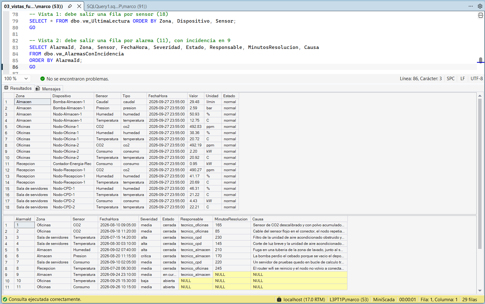

### Procedimientos

Los he llamado `usp_` y no `sp_`, porque `sp_` está reservado para los procedimientos del sistema y SQL Server los busca primero en la base de datos `master`.

- `usp_RegistrarAlarma` crea una alarma nueva y devuelve su identificador. Comprueba que el sensor existe y que la severidad es una de las permitidas, y si no, da un error con un mensaje claro.
- `usp_CerrarIncidencia` cierra la incidencia de una alarma. Si la alarma ya tenía una incidencia abierta la completa, y si no tenía, crea una ya cerrada.

Los dos usan parámetros y no construyen SQL con texto, así que no se pueden aprovechar para inyectar SQL.

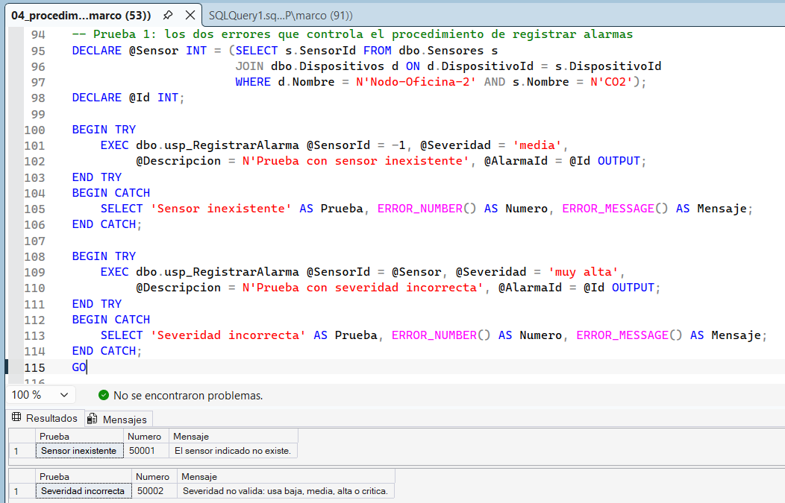

### Trigger

El trigger `trg_Incidencias_EstadoAlarma` actualiza solo el estado de la alarma cuando cambia su incidencia: si se abre una incidencia, la alarma pasa a "en curso", y si se cierra, pasa a "cerrada". Así no depende de que cada programa o usuario se acuerde de cambiar el estado. Está hecho para funcionar también cuando se tocan varias filas a la vez.

La prueba la hago dentro de una transacción que luego deshago, para no cambiar los datos. En la captura se ve cómo la misma alarma pasa de abierta a en curso y a cerrada:

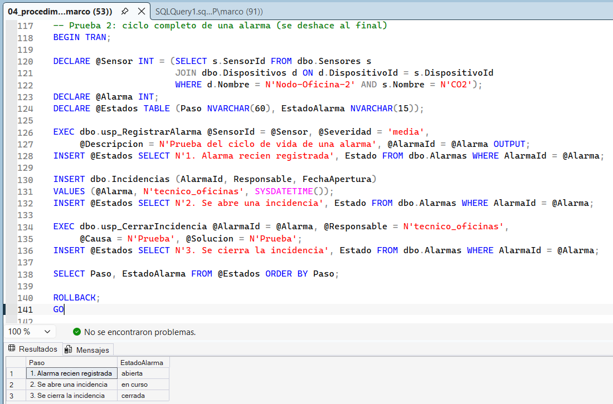

### Consultas avanzadas

Las consultas están en [database/05_consultas_avanzadas.sql](database/05_consultas_avanzadas.sql). Son solo de lectura y cada una responde a una pregunta del sistema.

**CTE.** Una expresión de tabla común sirve para resumir primero los datos y luego filtrar sobre el resumen.

- La primera resume las lecturas por sensor y día, y enseña los días en los que algún sensor se salió de su rango normal. Salen exactamente los días en que metí anomalías.
- La segunda busca sensores "planos": agrupa las lecturas por hora y se queda con las horas en las que las 12 lecturas valen lo mismo (desviación cero). Encuentra los dos sensores de CO2 que se quedaron fijos, algo que mirando solo el rango no se vería, porque su valor era normal.

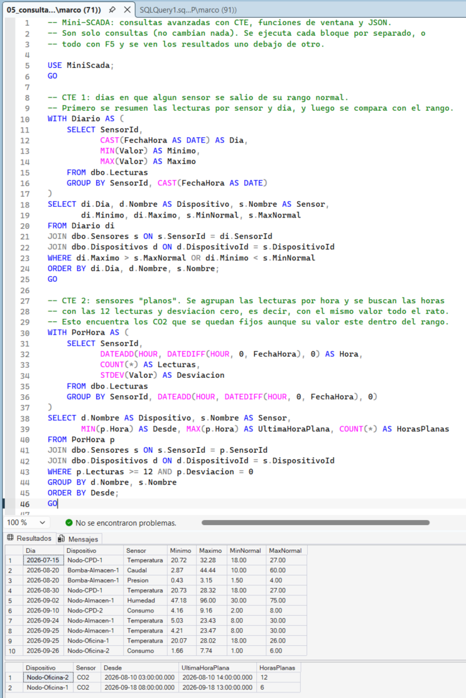

**Funciones de ventana.** Permiten calcular sobre un grupo de filas sin juntarlas en una sola.

- La primera da a cada alarma su puesto dentro de su zona según lo que tardó en resolverse (`RANK`) y cuántas alarmas lleva acumuladas la zona. Las alarmas sin resolver quedan en último lugar.
- La segunda calcula la media móvil de la última hora de la temperatura de la sala de servidores el día del fallo de refrigeración. Se ve cómo la media sube con retraso respecto al valor real cuando la temperatura salta de 22 a 32 grados.

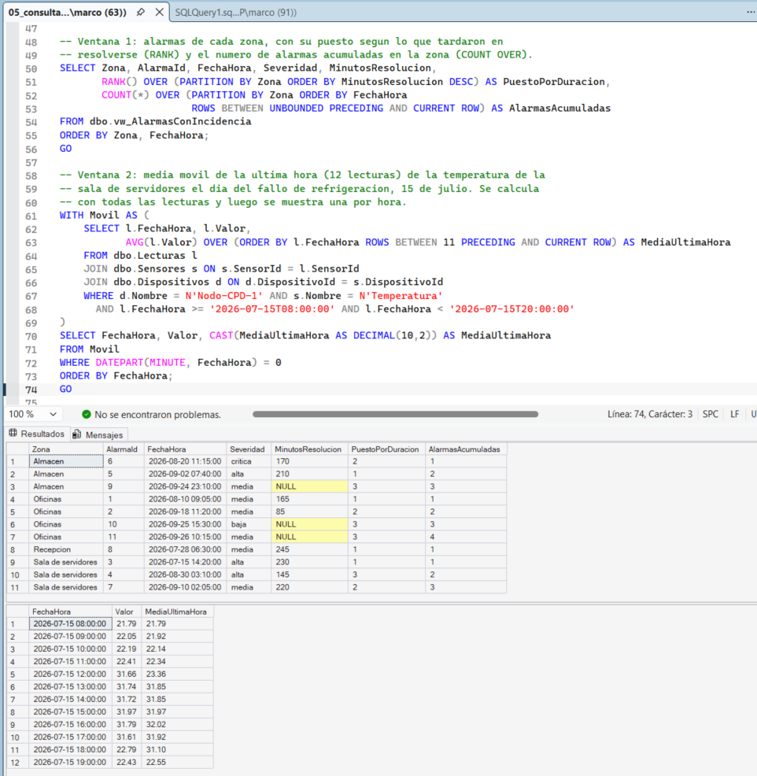

**JSON.** Cada lectura guarda el mensaje original del dispositivo, y se puede consultar sin haberlo separado en columnas.

- `JSON_VALUE` saca la batería y la señal de cada mensaje, y con eso calculo la batería media y la señal mínima de cada dispositivo.
- `OPENJSON` abre un mensaje y lo convierte en una fila por campo.

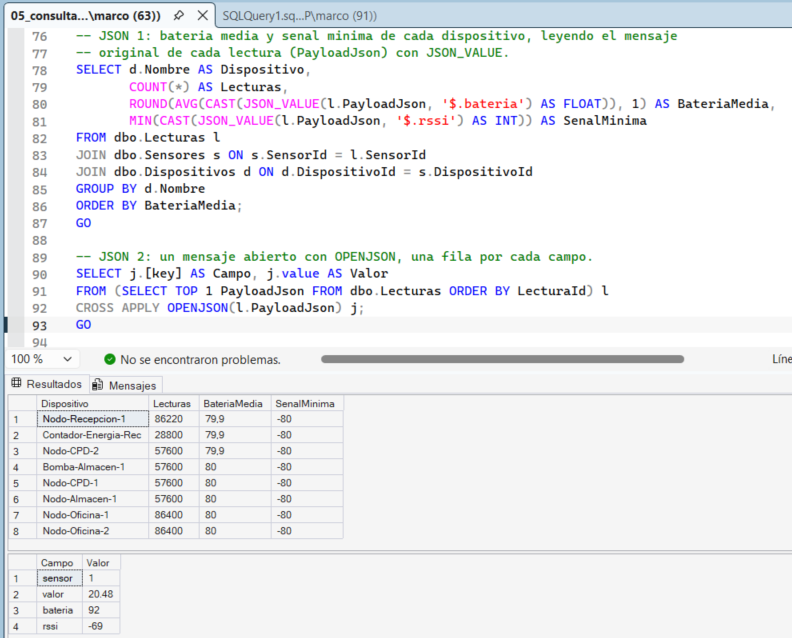

### Pruebas

[tests/tests.sql](tests/tests.sql) comprueba de una vez que todo lo anterior está en su sitio: las 8 tablas, las columnas de tipo vector, la función, las vistas, los procedimientos y el trigger, que hay más de 500.000 lecturas, que el `CHECK` rechaza un rango al revés, que el procedimiento da error con un sensor que no existe y que el trigger cierra la alarma. Con la seguridad y la optimización añade que la política por filas está activa, que el administrador ve 11 alarmas y el técnico de la sala de servidores 3, que este último no puede leer la tabla `Lecturas`, que el email sale tapado para el técnico y que existe el índice. Con los embeddings y el RAG comprueba que los 10 documentos y las 11 alarmas tienen su vector, que existen los procedimientos de búsqueda y de RAG, que la pregunta del sensor de CO2 plano devuelve su procedimiento y que la alarma más parecida a un servidor que se calienta es de la sala de servidores. Al final sale una tabla con OK o FALLO por cada prueba. Las que tocan datos se hacen dentro de una transacción que se deshace, y he ido ampliándolo con cada fase. Ahora son 18 pruebas. Las de los embeddings llaman a Ollama, así que tiene que estar en marcha.

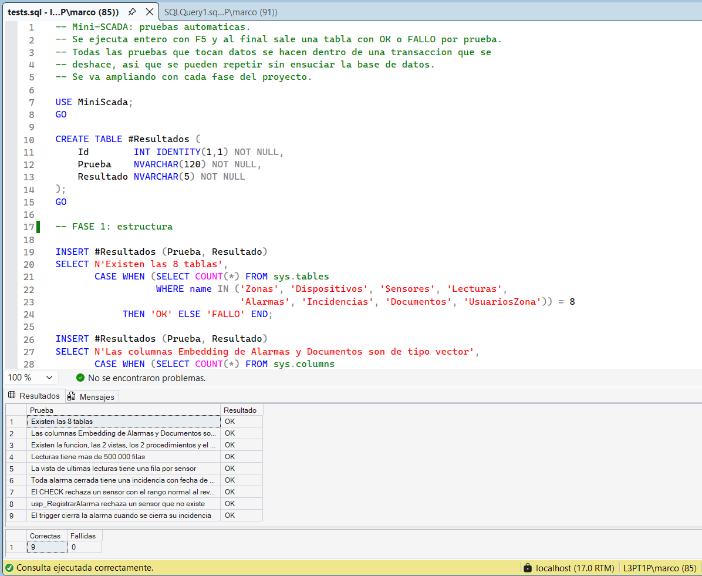


## Seguridad

La seguridad está en [database/06_seguridad.sql](database/06_seguridad.sql) y sus pruebas en [database/07_seguridad_pruebas.sql](database/07_seguridad_pruebas.sql). La idea es que cada persona vea solo lo que necesita para su trabajo.

### Quién es quién

Hay dos roles y cuatro usuarios. Los usuarios los he creado sin login (`CREATE USER ... WITHOUT LOGIN`), así que no se pueden usar para conectarse a SQL Server, solo para probar con `EXECUTE AS` desde mi sesión. De esa forma no hay ninguna contraseña en el proyecto.

| Usuario | Rol | Zonas que ve | Emails de contacto | Tabla Lecturas |
| --- | --- | --- | --- | --- |
| admin_scada | rol_admin_scada | Todas | Completos | Acceso total |
| tecnico_cpd | rol_tecnico | Sala de servidores | Enmascarados | Denegado, solo con la vista |
| tecnico_oficinas | rol_tecnico | Recepcion y Oficinas | Enmascarados | Denegado, solo con la vista |
| tecnico_almacen | rol_tecnico | Almacen | Enmascarados | Denegado, solo con la vista |

Qué zonas tiene cada técnico lo dice la tabla `UsuariosZona`. Si mañana hay que darle otra zona a un técnico, se añade una fila y no hay que tocar ningún permiso.

### Seguridad por filas

Con Row-Level Security, SQL Server filtra las filas según quién consulta, sin que la consulta tenga que cambiar. Lo he aplicado a Zonas, Dispositivos, Sensores, Alarmas e Incidencias, y además hay un bloqueo para que un técnico no pueda crear alarmas ni incidencias en una zona que no es la suya. El administrador y yo (como `db_owner`) lo vemos todo.

La misma consulta con los dos usuarios. El administrador ve las 4 zonas y las 11 alarmas:

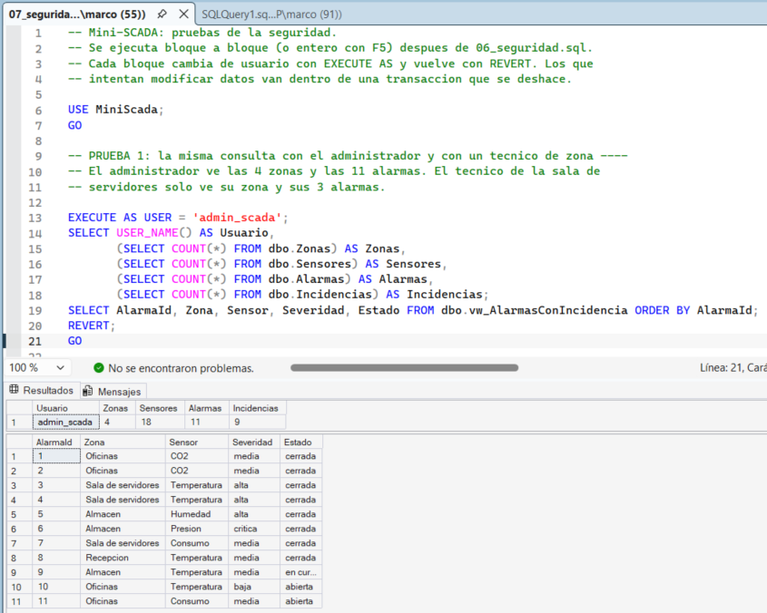

Y el técnico de la sala de servidores ve solo su zona y sus 3 alarmas:

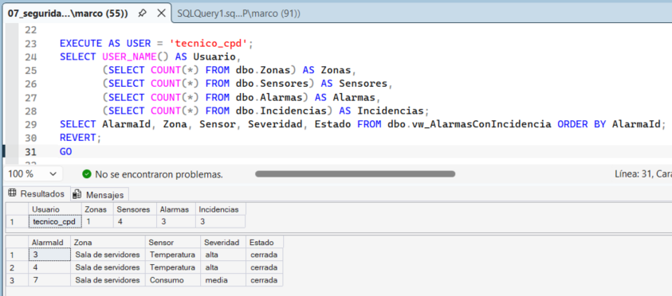

A la tabla Lecturas, que tiene más de 500.000 filas, no le he puesto seguridad por filas, para no añadir una comprobación a cada fila en cada consulta. En su lugar, el técnico no puede leerla directamente (`DENY`) y consulta las lecturas con la vista `vw_LecturasVisibles`, que hereda la seguridad de la tabla Sensores y por eso solo le deja ver las de sus sensores. Es una decisión que tomé por el rendimiento, y a cambio la seguridad de esta tabla depende de que nadie le dé permisos directos.

### Enmascarado de datos

El email de contacto de cada zona está enmascarado con Dynamic Data Masking. El administrador, que tiene el permiso `UNMASK`, lo ve completo, y los técnicos lo ven tapado (solo se ve la primera letra):

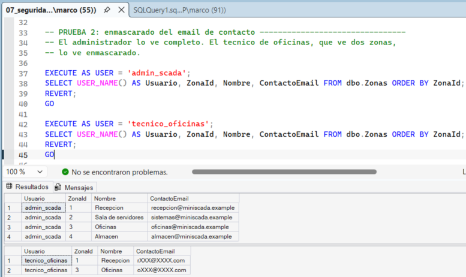

### Permisos mínimos

El técnico tiene solo lo necesario para su trabajo: puede leer las alarmas, incidencias, sensores y manuales de sus zonas, y registrar o cerrar alarmas con los dos procedimientos. No puede borrar alarmas ni incidencias, ni modificar zonas, dispositivos o sensores, ni tocar la tabla Lecturas. Cada uno de esos permisos está dado con `GRANT` o quitado con `DENY` en el script.

Probé qué pasa cuando el técnico de la sala de servidores intenta lo que no debe, dentro de una transacción que se deshace:

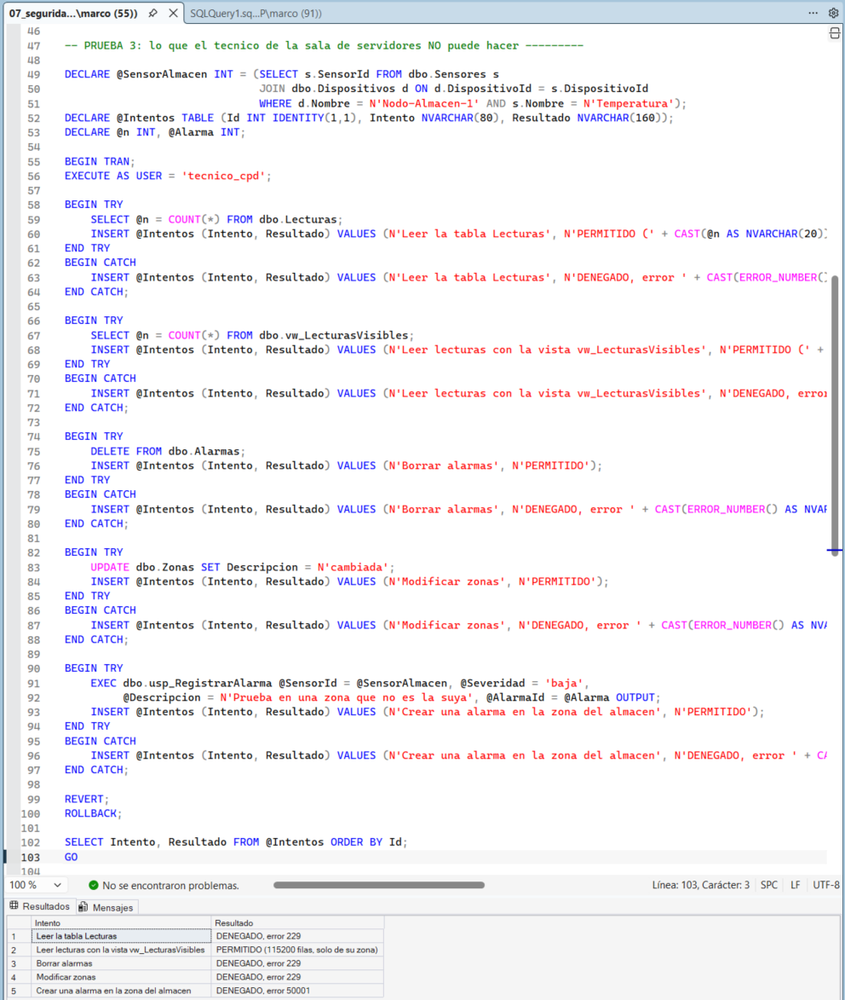

El error 229 es "permiso denegado". Crear una alarma en una zona ajena da el error 50001 ("el sensor no existe"), porque el técnico ni siquiera ve los sensores de otras zonas.

## Optimización de una consulta

El script es [database/08_optimizacion.sql](database/08_optimizacion.sql). Se ejecuta bloque a bloque y se puede repetir, porque lo primero que hace es borrar el índice si existe.

### La consulta

Elegí la que más se parece a lo que haría un técnico en el día a día: la media de CO2 de la oficina 1 durante una semana (del 1 al 8 de agosto).

```sql
SELECT AVG(Valor) AS MediaCO2, COUNT(*) AS Lecturas
FROM dbo.Lecturas
WHERE SensorId = @SensorId AND FechaHora >= @Desde AND FechaHora < @Hasta;
```

Devuelve 2.016 lecturas (288 al día durante 7 días) y una media de 619,98 ppm. El problema es que Lecturas tiene más de 500.000 filas y solo una clave primaria, por `LecturaId`. Ahí no sirve de nada buscar por sensor y fecha.

### Antes: sin índice

SQL Server no tiene otra opción que recorrer toda la tabla. El plan es un `Clustered Index Scan` que se lleva el 98 % del coste, y hasta me avisa de que falta un índice (con un impacto estimado del 99 %):

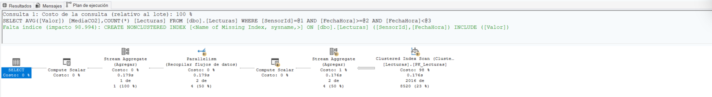

Medido con `SET STATISTICS IO, TIME ON` y vaciando antes la caché (`DBCC DROPCLEANBUFFERS`) para que las dos mediciones partan igual:

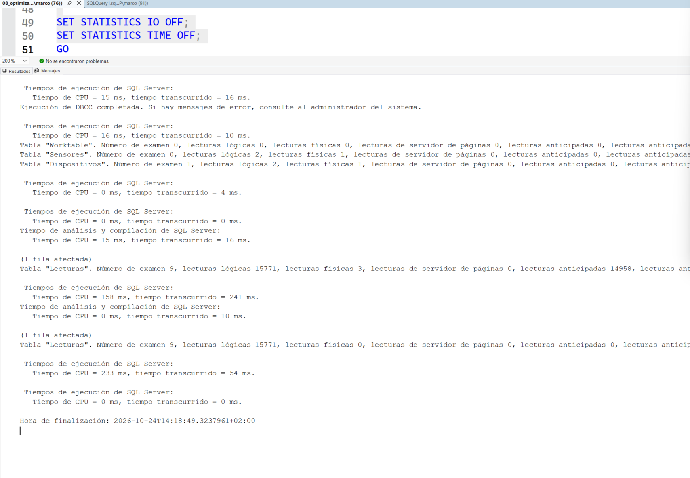

Son 15.771 lecturas lógicas (páginas leídas) y SQL Server tiene que usar varios hilos en paralelo para sacarlo. Con la caché fría tarda 241 ms, y con la caché caliente 54 ms pero con 233 ms de CPU, porque trabajan varios hilos a la vez.

### El índice

```sql
CREATE NONCLUSTERED INDEX IX_Lecturas_Sensor_Fecha
ON dbo.Lecturas (SensorId, FechaHora)
INCLUDE (Valor);
```

El orden de las columnas importa: primero `SensorId`, que se compara con igualdad, y después `FechaHora`, que es el rango. Así SQL Server va directo al trozo del índice que es de ese sensor y de esa semana. `Valor` va con `INCLUDE` porque es lo único que necesita para calcular la media, y así no tiene que volver a la tabla a buscarlo (es un índice "cubriente").

### Después: con índice

Ahora el plan es un `Index Seek` sobre el nuevo índice:

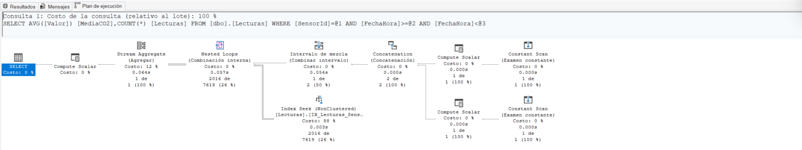

Los operadores `Constant Scan` y `Intervalo de mezcla` que aparecen a su lado no cuestan nada (0 %), son la forma que tiene SQL Server de preparar el rango de fechas. Las lecturas:

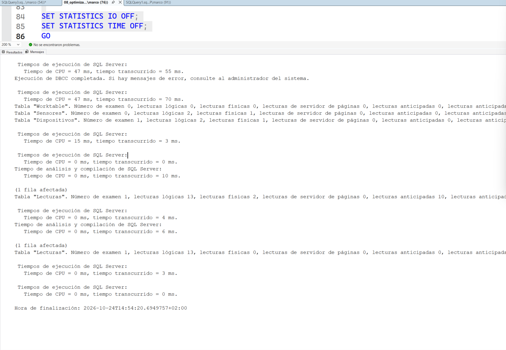

| | Sin índice | Con índice |
| --- | --- | --- |
| Operador | Clustered Index Scan | Index Seek |
| Lecturas lógicas | 15.771 | 13 |
| Tiempo con caché fría | 241 ms | 4 ms |
| Tiempo con caché caliente | 54 ms (233 ms de CPU) | 3 ms (0 ms de CPU) |

Lee unas 1.200 veces menos páginas. En tiempo la diferencia es menor (de 241 ms a 4 ms con la caché fría), porque con solo 500.000 filas, en mi equipo hasta recorrer la tabla entera es bastante rápido. Pero la tabla crece cada 5 minutos por cada sensor y las lecturas lógicas crecerían con ella, mientras que las del índice casi no cambian.

### Lo que cuesta el índice

Un índice no es gratis. Este ocupa unos 16,7 MB, frente a los 117 MB de la tabla, y cada lectura nueva que llega tiene que escribirse también en él. Para un sistema como este, que casi solo inserta lecturas y las consulta por sensor y rango de fechas, me compensa. Si la tabla recibiera muchísimas escrituras y casi nunca se consultara por sensor y fecha, no lo crearía.

Un detalle: en la captura del plan escribí el id del sensor (11) directamente en la consulta en lugar de usar variables, para que el plan saliera solo y se leyera bien. Con variables y `OPTION (RECOMPILE)`, que es lo que hace el script, el plan es el mismo.

## Embeddings

Un embedding es una lista de números que representa el significado de un texto, de forma que dos textos que hablan de lo mismo quedan con vectores parecidos aunque no compartan las mismas palabras. Los scripts de esta parte son [database/09_documentos.sql](database/09_documentos.sql) (los manuales), [database/10_embeddings.sql](database/10_embeddings.sql) (generar los vectores) y [database/11_busqueda.sql](database/11_busqueda.sql) (la búsqueda).

- **Modelo:** `nomic-embed-text`, que corre en mi equipo con Ollama. SQL Server lo llama a través del modelo externo `ModeloEmbeddings` que creé en la parte de entorno (con el proxy nginx por delante, porque SQL Server solo habla HTTPS).
- **Qué se convierte en vector:** la descripción de cada alarma (`Alarmas.Descripcion`) y el título junto con el contenido de cada manual (`Documentos.Titulo` y `Documentos.Contenido`). Le pongo el título delante del contenido para que también cuente a la hora de buscar.
- **Dimensión:** 768, que es lo que devuelve ese modelo. Por eso las columnas son `VECTOR(768)`.
- **Cómo se generan:** con la función `AI_GENERATE_EMBEDDINGS` dentro de un `UPDATE`, así que no hace falta ningún programa externo: lo hace SQL Server llamando a Ollama.
- **Cómo se guardan:** en las columnas `Embedding` de `Alarmas` y de `Documentos`, que son de tipo `VECTOR(768)`.

```sql
UPDATE dbo.Documentos
SET Embedding = AI_GENERATE_EMBEDDINGS(CONCAT(Titulo, N'. ', Contenido) USE MODEL ModeloEmbeddings)
WHERE Embedding IS NULL;
```

Los manuales los escribí yo para el proyecto: son diez documentos cortos (procedimientos, manuales y guías) sobre lo que haría un técnico ante cada tipo de alarma. Generar los 21 embeddings (11 alarmas y 10 documentos) tardó unos 10 segundos. La comprobación final cuenta las filas con embedding y sus dimensiones:

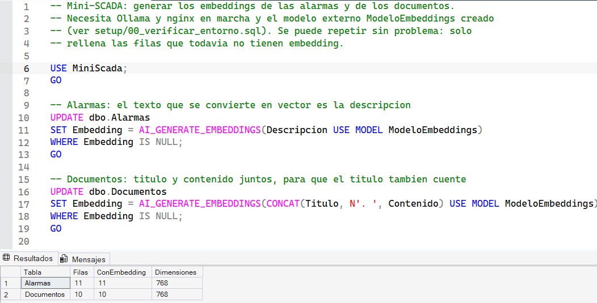

## Búsqueda semántica

Para buscar, la pregunta se convierte en un vector con el mismo modelo y se ordenan los documentos por su distancia a ese vector con `VECTOR_DISTANCE`. Lo he dejado en el procedimiento `usp_BuscarDocumentos`, que luego me servirá para el RAG.

Uso la distancia **coseno**. Compara hacia dónde apuntan los dos vectores y no lo largos que son, que es lo que interesa con textos: un manual largo y una pregunta corta pueden hablar de lo mismo, y la longitud del texto no debería cambiar cuánto se parecen. Con la distancia euclídea, un texto largo y uno corto del mismo tema podrían salir más lejos solo por el tamaño. Cuanto más cerca de 0, más parecido.

Probé cinco preguntas escritas como las diría un técnico, sin copiar las palabras de los manuales:

| Pregunta | Primer resultado | Distancia | Acierta |
| --- | --- | --- | --- |
| el sensor de CO2 marca siempre el mismo valor | Procedimiento: sensor de CO2 con lecturas planas | 0,1219 | Sí |
| se fue la luz y el aire de la sala de los servidores no vuelve a arrancar | Procedimiento: corte de luz y arranque de equipos | 0,2830 | Sí, y el manual de refrigeración queda segundo (0,3368) |
| hay mucha humedad en el almacen, creo que hay agua | Guía: humedad alta en el almacén | 0,1590 | Sí |
| la bomba no da presion y casi no sale agua | Manual: bomba de agua del almacén, caída de presión | 0,2756 | Sí |
| cuanto tiempo tengo para atender una alarma critica | Guía: severidad de las alarmas y tiempos de respuesta | 0,2054 | Sí |

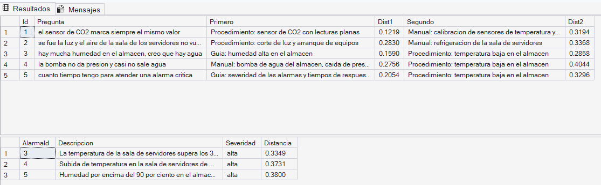

Acierta en las cinco, pero no todo es tan limpio. En la segunda pregunta mezclo dos cosas (el corte de luz y el aire de la sala) y salen los dos documentos que tratan de ellas, pero el de la refrigeración, que es el que da los pasos para rearmar el aire, queda segundo. Para un humano son igual de útiles. También se nota que `Procedimiento: temperatura baja en el almacen` aparece como segundo resultado en tres de las cinco preguntas, y solo una de ellas habla del almacén. Con solo diez documentos, uno bastante genérico se queda como relleno cerca de casi todo. Con más documentos esto se notaría menos.

También lo probé con las alarmas, buscando las parecidas a un problema nuevo (`usp_BuscarAlarmasSimilares`). Para "el servidor se calienta demasiado" salen primero las dos alarmas de la sala de servidores (la 3 y la 4), que es lo esperado. La tercera, de humedad, ya no tiene mucho que ver y está a más distancia.

No he creado un índice vectorial porque con diez documentos y once alarmas la búsqueda exacta recorre todo en un instante. Para miles de documentos sí compensaría.

## RAG con un modelo local

RAG quiere decir que el modelo no contesta de memoria: primero busco en la base de datos los documentos que tratan de la pregunta y se los doy al modelo para que conteste solo con eso. Es justo lo que hace el procedimiento `usp_PreguntarRAG` (`database/12_rag.sql`):

1. La pregunta se convierte en un vector con el mismo modelo de embeddings de antes.
2. Con `VECTOR_DISTANCE` (coseno) cojo los dos documentos más cercanos, reutilizando la idea de `usp_BuscarDocumentos`.
3. Con los textos de esos documentos monto el prompt: "contesta en español, en tres frases como máximo, usando solo estos documentos; si la respuesta no está, di exactamente: No lo encuentro en los manuales."
4. Llamo a Ollama desde T-SQL con `sp_invoke_external_rest_endpoint` (`/api/chat`, a través del mismo proxy HTTPS) y leo la respuesta del JSON con `JSON_VALUE`.

La generación no se puede hacer con `CREATE EXTERNAL MODEL`, porque SQL Server 2025 solo admite modelos externos de tipo embeddings. Por eso la parte de generar texto va por REST.

**Qué hace SQL Server y qué hace el modelo.** Son dos cosas distintas y el RAG las junta:

- **SQL Server** guarda los manuales y sus vectores, y es quien busca: compara la pregunta con los documentos (`VECTOR_DISTANCE`) y decide cuáles se parecen más. También monta el contexto. Sabe qué dice mi documentación, pero no redacta.
- **El modelo de lenguaje (Llama)** solo redacta la respuesta con el contexto que recibe. No tiene acceso a mi base de datos ni sabe nada de mi instalación: lo que sabe de memoria es genérico, y por eso sin documentos se inventa plazos.

Dicho en una línea: SQL Server + búsqueda vectorial + contexto + modelo local = RAG.

**Modelo.** Uso `Llama-3.2-3B-Instruct` cuantizado a Q4_K_M (unos 1,9 GB). Quería uno pequeño que funcione en mi portátil sin GPU y que sepa español. Lo normal era `ollama pull llama3.2:3b`, pero a mí me fallaba la descarga (mi red no llegaba al CDN de Ollama), así que lo bajé de Hugging Face con `ollama pull hf.co/bartowski/Llama-3.2-3B-Instruct-GGUF:Q4_K_M`, que es el mismo modelo. Pongo temperatura 0 y `seed` 42 para que las respuestas se parezcan lo más posible de una ejecución a otra. Además tuve que subir `proxy_read_timeout` a 300 s en nginx (está en `setup/nginx.conf`), porque con los 60 s por defecto el proxy cortaba la llamada antes de que el modelo acabara. El script entero (ocho respuestas) tarda algo más de un minuto, y la primera vez bastante más porque Ollama tiene que cargar el modelo.

**Con y sin RAG.** El script hace las mismas cuatro preguntas dos veces, una sin documentos (`sin RAG`) y otra con ellos (`con RAG`). Las respuestas salen troceadas en líneas de 110 caracteres para que quepan en la rejilla de SSMS (a veces el corte cae en mitad de una palabra).

| Pregunta | Sin RAG | Con RAG |
| --- | --- | --- |
| Cuánto tiempo tengo para atender una alarma de severidad alta | Se inventa "15-30 minutos" | "Máximo de 1 hora", que es lo que dice la guía de severidades |
| Cada cuánto se calibran los sensores de temperatura y humedad y con qué se comprueban | "Cada 3 meses" y una explicación genérica | Cada seis meses, termómetro de referencia a 20 grados, cámara de sal a 75 % y ajustar el offset si la desviación pasa de 1 grado o 3 puntos |
| Qué hago si la presión de la bomba del almacén baja de 1 bar | Consejos generales ("verifica que la bomba esté funcionando correctamente") | Parar la bomba para no quemar el motor y las causas habituales: cebado perdido, filtro obstruido, válvula cerrada o junta del eje |
| Qué hago si hay un incendio en la sala de servidores | Da consejos inventados ("apaga el interruptor de la luz...") | "No lo encuentro en los manuales." |

Para ver el RAG paso a paso con una sola pregunta está [database/13_rag_demo.sql](database/13_rag_demo.sql). Enseña la pregunta, los documentos que recupera con su distancia, el contexto exacto que recibe el modelo y la respuesta. Con "el sensor de CO2 de la oficina marca siempre lo mismo, que hago" recupera el procedimiento del sensor de CO2 plano (distancia 0,1309) y, en segundo lugar, el manual de calibración (0,3137). El modelo contesta con los pasos del primero: comparar con el otro sensor de CO2 de la planta, revisar la entrada de aire y, si sigue sin moverse, sustituir el sensor y anotar el número de serie. Tarda unos 23 segundos.

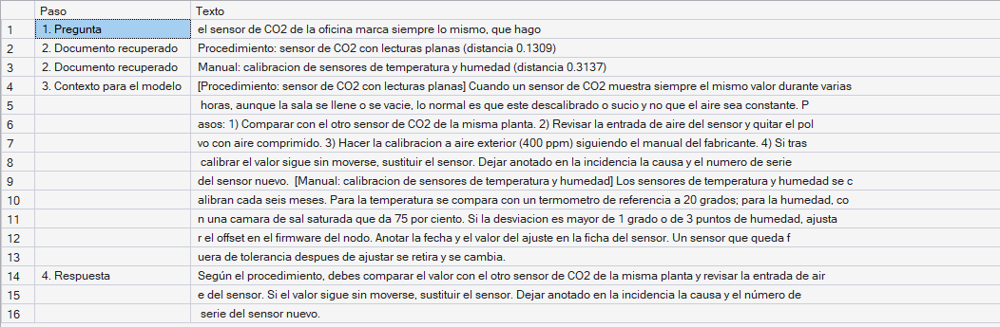

Y la comparación de las cuatro preguntas sin y con RAG:

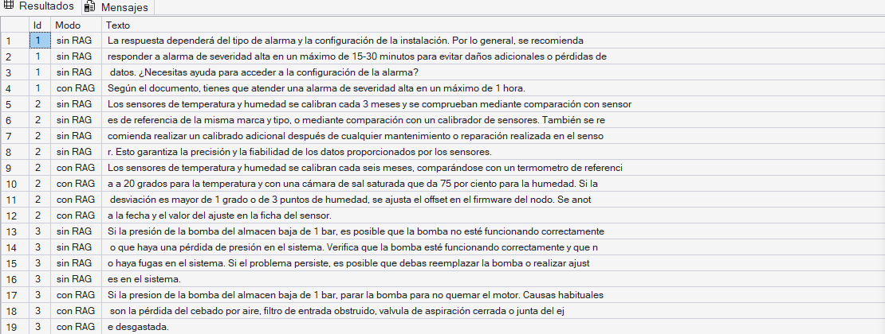

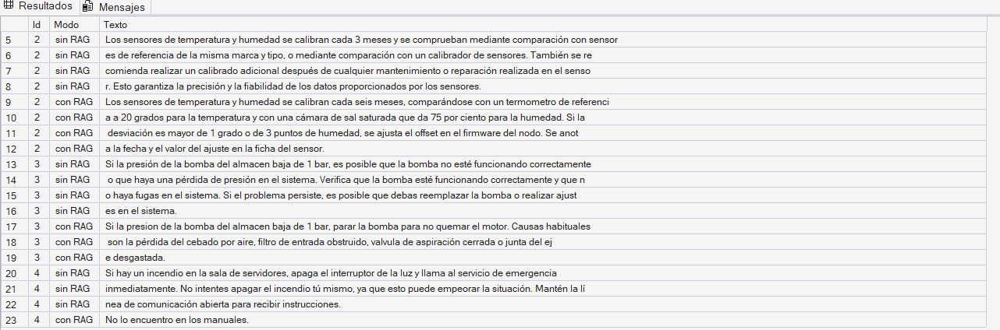

Lo más claro es la diferencia en las dos primeras: sin RAG el modelo contesta con seguridad números que no vienen de mis manuales (15-30 minutos, cada 3 meses), y con RAG da los de mi documentación. La cuarta es la que más me gusta: ese incendio no está en ningún manual, y con RAG el modelo lo reconoce en vez de inventarse un procedimiento, que en un sistema de alarmas es lo que importa. Sin RAG da un consejo inventado que no se puede fiar.

**Límites.** Es un modelo de 3.000 millones de parámetros: va lento sin GPU y, aunque pongo temperatura 0, no me fío de que la redacción sea idéntica siempre. Además solo ve dos documentos, así que si el buscador falla, la respuesta falla (el RAG no es mejor que la búsqueda que tiene debajo). Por eso el procedimiento devuelve también los documentos que usó (parámetro `@Contexto`), para poder comprobar de dónde sale cada respuesta.

## Ejemplos

Tres consultas que, para mí, resumen el proyecto. Los resultados son los de mi equipo y salen igual al repetirlas.

**1. Buscar por significado.** El técnico escribe lo que ve y no el título del manual:

```sql
EXEC dbo.usp_BuscarDocumentos @Pregunta = N'el sensor de CO2 marca siempre el mismo valor', @Cantidad = 3;
```

Devuelve primero "Procedimiento: sensor de CO2 con lecturas planas", con una distancia coseno de 0,1219. La palabra "planas" no está en la pregunta.

**2. Cada usuario ve lo suyo.** La misma consulta con dos usuarios distintos:

```sql
EXECUTE AS USER = 'admin_scada';
SELECT COUNT(*) FROM dbo.Alarmas;   -- 11
REVERT;

EXECUTE AS USER = 'tecnico_cpd';
SELECT COUNT(*) FROM dbo.Alarmas;   -- 3, solo las de la sala de servidores
REVERT;
```

**3. Un índice que se nota.** La consulta de la media de CO2 de un sensor pasó de un `Clustered Index Scan` con 15.771 lecturas lógicas y 241 ms a un `Index Seek` con 13 lecturas lógicas y 4 ms, con el mismo resultado (619,98 ppm).

## Informe y presentación

El informe de 10 páginas con las capturas de cada parte está en [docs/informe.pdf](docs/informe.pdf), y la presentación de 8 diapositivas en [presentation/dp800-project.pptx](presentation/dp800-project.pptx).

## Conclusiones

Lo que más me ha enseñado el proyecto es que la parte de IA, con SQL Server 2025, es sorprendentemente corta de escribir: un `UPDATE` con `AI_GENERATE_EMBEDDINGS` para rellenar los vectores y un `ORDER BY VECTOR_DISTANCE` para buscar. Lo difícil fue todo lo de alrededor. Conseguir que SQL Server hablara con Ollama fue lo que más tiempo me llevó (HTTPS, certificados de mkcert que el servicio no veía, nginx), y más tarde la descarga del modelo, que no funcionaba con el comando normal y tuve que bajar de Hugging Face, y el tiempo de espera del proxy, que cortaba la generación a los 60 segundos.

También me quedo con lo del RAG. Antes de hacerlo pensaba que sería un detalle de calidad, pero la diferencia es enorme: sin documentos el modelo se inventa plazos y periodos con total seguridad, y con ellos contesta lo que dicen mis manuales y, si no lo encuentra, lo dice. En un sistema de alarmas eso es lo que más me importa.

Los errores de T-SQL fueron pequeños pero me enseñaron cosas: una columna `IDENTITY` en una tabla temporal que no se reiniciaba con `DELETE` (con `TRUNCATE TABLE` sí), y `GENERATE_SERIES` que exige que los dos extremos sean del mismo tipo y `LEN` devuelve `BIGINT`.

Lo que mejoraría:

- Probar más preguntas y más documentos. Con diez documentos todo acierta, pero no sé cómo se comportaría la búsqueda con cientos de manuales, y entonces sí haría falta un índice vectorial.
- Usar una máquina con GPU. El modelo de 3.000 millones de parámetros va bien para esto, pero tarda segundos por respuesta, y con una GPU podría probar uno más grande.
- Recibir los datos de verdad desde los sensores (por ejemplo por MQTT, como en un SCADA real) en vez de simularlos con un script.
- Guardar en una tabla cada pregunta con sus documentos y su respuesta, para poder revisar después si el RAG se equivoca.

## Uso de IA durante el desarrollo

He usado Claude como guía durante todo el proyecto: para ordenar las fases, para que me escribiera los scripts de cada una (tablas, generador de datos, procedimientos, seguridad, embeddings, RAG), para redactar los diez documentos de prueba y para resolver los errores que me fueron saliendo. Todo lo que me dio lo probé en mi SQL Server antes de aceptarlo, y varias veces tuvo que corregirse (los fallos de `IDENTITY` y de `GENERATE_SERIES` que cuento arriba, el modelo que no se descargaba, el tiempo de espera de nginx). Por cada parte importante anoté mis dudas, qué acepté, qué hubo que corregir y cómo lo verifiqué. Las diez fichas completas están en [docs/uso-de-ia.md](docs/uso-de-ia.md).

## Instalación paso a paso (desde cero)

Esta guía es para reproducir el proyecto en un Windows 11 sin nada instalado, sin conocimientos previos. Lleva más o menos una hora, casi toda en descargas e instalaciones (los dos modelos de Ollama pesan unos 2,5 GB en total). No hace falta tarjeta gráfica. Cada paso termina con lo que tienes que ver para saber que ha ido bien.

### Qué hay que instalar

| Programa | Para qué | Dónde |
| --- | --- | --- |
| Git | Descargar el repositorio | `winget install Git.Git` en PowerShell, o git-scm.com |
| SQL Server 2025, edición Developer (gratuita) | La base de datos | microsoft.com/sql-server/sql-server-downloads |
| SQL Server Management Studio (SSMS) 22 | Ejecutar los scripts y ver los resultados | aka.ms/ssmsfullsetup |
| Ollama | Ejecutar los modelos en local | ollama.com/download |
| nginx para Windows | Proxy HTTPS entre SQL Server y Ollama | nginx.org/en/download.html (versión estable, archivo zip) |
| mkcert | Certificado HTTPS local | `winget install FiloSottile.mkcert` en PowerShell |

Al instalar SQL Server vale la instalación básica, con la instancia por defecto y la autenticación de Windows. Con eso el servidor se llama `localhost`.

### Paso 1. Descargar el proyecto

En PowerShell:

```powershell
git clone https://github.com/MartinezDelAlamoMarco/dp800-mini-scada.git
cd dp800-mini-scada
```

Todas las rutas de esta guía (`database\...`, `setup\...`, `tests\...`) son relativas a esta carpeta.

### Paso 2. Descargar los dos modelos de Ollama

Abre Ollama desde el menú Inicio (se queda en la bandeja del sistema, junto al reloj) y en PowerShell escribe:

```powershell
ollama pull nomic-embed-text
ollama pull hf.co/bartowski/Llama-3.2-3B-Instruct-GGUF:Q4_K_M
```

El primero convierte textos en vectores y el segundo redacta las respuestas del RAG. Para comprobarlo escribe `ollama list`: tienen que salir los dos.

### Paso 3. Certificado HTTPS local

SQL Server solo llama a servicios HTTPS y Ollama habla HTTP, así que hay que poner un proxy en medio y darle un certificado. En PowerShell **como administrador** (clic derecho en PowerShell, "Ejecutar como administrador"):

```powershell
mkcert -install
mkdir C:\certs
cd C:\certs
mkcert localhost 127.0.0.1 ::1
certutil -addstore -f "ROOT" "$(mkcert -CAROOT)\rootCA.pem"
```

Si `mkcert` no se reconoce, cierra PowerShell y ábrelo otra vez. Windows te preguntará si confías en el certificado: di que sí. Al terminar tienen que existir `C:\certs\localhost+2.pem` y `C:\certs\localhost+2-key.pem`.

Después reinicia el servicio de SQL Server para que use ese certificado: pulsa Windows + R, escribe `services.msc`, busca "SQL Server (MSSQLSERVER)", clic derecho y Reiniciar.

### Paso 4. nginx

1. Descomprime el zip de nginx de forma que quede `C:\nginx\nginx.exe`.
2. Copia la configuración del proyecto. Desde la carpeta del repositorio: `copy setup\nginx.conf C:\nginx\conf\nginx.conf` (di que sí a sobrescribir).
3. Arranca nginx:

```powershell
cd C:\nginx
start .\nginx
curl.exe --ssl-no-revoke https://localhost:11435/api/tags
```

La última línea tiene que devolver un JSON con los dos modelos que descargaste. Si da error de conexión, nginx no está en marcha; si se queja del certificado, repite el paso 3. Para pararlo: `.\nginx -s stop`.

### Paso 5. Conectar SSMS y preparar SQL Server

1. Abre SSMS. En la ventana de conexión pon como nombre del servidor `localhost`, autenticación "Autenticación de Windows" y marca "Confiar en el certificado del servidor". Pulsa Conectar.
2. Abre el primer script: Archivo, Abrir, Archivo, y elige `setup\00_verificar_entorno.sql` del repositorio.
3. Pulsa **F5** (o el botón Ejecutar). Activa las llamadas REST, comprueba que llegan al proxy, crea la base de datos `MiniScada` y el modelo externo y genera un vector de prueba. Al final, en la pestaña Resultados, tiene que salir una fila con un vector (una cadena de números entre corchetes). Si sale el error 31608, nginx o Ollama no están en marcha.

Todos los scripts siguientes se abren y ejecutan igual: Archivo, Abrir, Archivo, F5. Mira siempre la pestaña **Resultados** y la pestaña **Mensajes**: no deben aparecer mensajes en rojo.

### Paso 6. Crear la base de datos y todo lo demás

Ejecuta con F5, uno detrás de otro y en este orden, los scripts de `database\`:

| Script | Qué hace |
| --- | --- |
| `01_tablas` | Crea las 8 tablas, con sus claves y restricciones |
| `02_datos` | Genera unas 518.000 lecturas, alarmas, incidencias y zonas de prueba |
| `03_vistas_funcion` | Crea la función y las vistas |
| `04_procedimientos_trigger` | Crea los procedimientos y el trigger |
| `05_consultas_avanzadas` | Consultas con CTE, window functions y JSON |
| `06_seguridad` | Crea roles y usuarios, seguridad por filas y enmascarado de datos |
| `07_seguridad_pruebas` | Muestra que cada usuario ve datos distintos |
| `08_optimizacion` | Mide una consulta antes y después de crear un índice |
| `09_documentos` | Carga los 10 manuales de ejemplo |
| `10_embeddings` | Convierte alarmas y manuales en vectores (necesita Ollama y nginx) |
| `11_busqueda` | Búsqueda semántica: ranking de documentos por significado |
| `12_rag` | Crea el procedimiento del RAG y compara cuatro preguntas con y sin RAG (tarda unos 2 minutos) |

El `13_rag_demo` es opcional y enseña el RAG paso a paso con una pregunta: la pregunta, los documentos recuperados con su distancia, el contexto que recibe el modelo y la respuesta. Para probar tus propias preguntas, cambia el texto de la línea `DECLARE @Pregunta` (lo que va entre comillas) y vuelve a pulsar F5.

### Paso 7. Comprobar que todo está bien

Abre `tests\tests.sql` y pulsa F5. Al final aparece una tabla con una fila por prueba: tienen que salir **18 en OK y ninguna en FALLO**. Las pruebas que tocan datos se deshacen solas, así que se pueden repetir.

### Cada vez que vuelvas a trabajar con el proyecto

Antes de ejecutar nada de la parte de IA (`10` en adelante), tienen que estar abiertos Ollama y nginx (`cd C:\nginx` y `start .\nginx`). Con SQL Server en marcha, ya está.

### Si algo falla

| Síntoma | Causa probable |
| --- | --- |
| Error 31608 o `HRESULT: 0x80072efd` | nginx u Ollama no están en marcha |
| Error de certificado en SQL Server o curl | Falta importar el certificado (paso 3) o reiniciar el servicio de SQL Server |
| `mkcert` o `nginx` no se reconocen | Cierra y abre PowerShell; nginx se lanza con `.\nginx` |
| El RAG se corta a los 60 segundos | nginx no tiene el `nginx.conf` del proyecto: repite el paso 4 y recarga con `.\nginx -s reload` |
| `ollama pull llama3.2:3b` no descarga | Usa el nombre de `hf.co/...` de este paso 2 |

Todos los scripts se pueden repetir: `01_tablas` borra y vuelve a crear las tablas (y con ellas todos los datos), y los datos de `02_datos` salen siempre idénticos. Más detalle de cómo monté el proxy y los problemas que tuve está en [setup/ollama-https-proxy.md](setup/ollama-https-proxy.md).

### Cuánto tarda

Antes de dar esto por bueno lo probé borrando la base de datos `MiniScada` y ejecutando todo en ese orden. Salió sin ningún error y las 18 pruebas pasaron. Tardó unos 2 minutos y 6 segundos en total:

| Paso | Tiempo aproximado |
| --- | --- |
| `00_verificar_entorno` | 2 segundos |
| `01` a `08` (tablas, 518.000 lecturas, T-SQL, seguridad e índice) | 17 segundos |
| `09` a `11` (documentos, embeddings y búsqueda) | 5 segundos |
| `12_rag` (ocho respuestas del modelo) | 1 minuto y 40 segundos |
| `tests.sql` | 3 segundos |

Lo que más tarda es el RAG, y sobre todo la primera vez, porque Ollama tiene que cargar el modelo en memoria.
